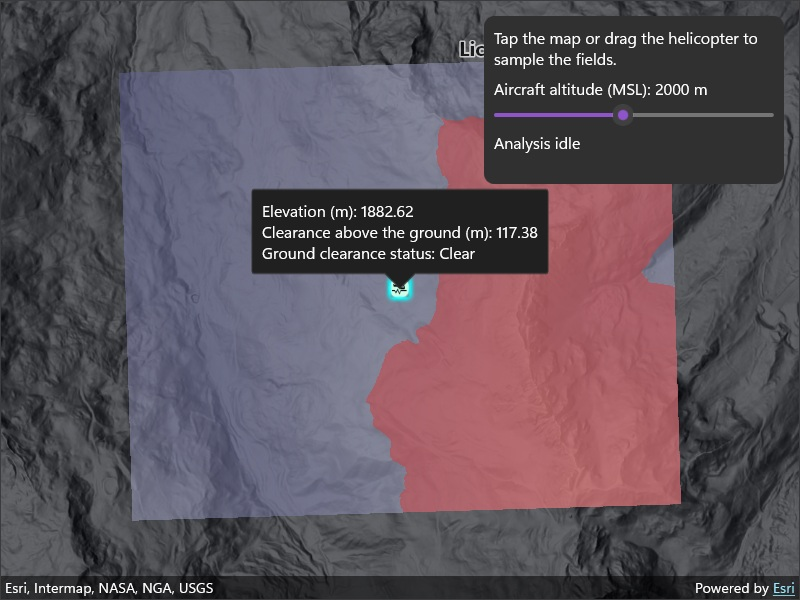

# Get field function value from a point

Sample field function values at a given position from a field analysis.

## Use case

Many spatial workflows depend on sampling a specific location and keeping the result current as information changes. In flight planning for an aircraft flying over uneven terrain, elevation and ground clearance at a location provide useful context, especially when readings reflect updates to the planned altitude of the aircraft.

## How to use the sample

The sample opens displaying both an elevation field (purple-gray tones) and a boolean field that shows where an aircraft flying with an altitude of 2000m above sea level would not have ground clearance (red). The ground clearance field is determined by comparing the elevation field with an altitude value. A callout in the centre of the data displays the values of each field, which have been sampled from the callout's position. Tap the map, or drag the sampling point, to sample the values of each field across the data extent. Use the control panel to adjust the altitude value and see the ground clearance's spatial extent update across the map. The tapped position's sampled value of the ground clearance boolean field will update automatically.

Red areas indicate terrain that would have no ground clearance given the set altitude value.

## How it works

1. Create a `Map` and set it on a `MapView`.
2. Add a `GraphicsOverlay` to the map view to draw the point for sampling.
3. Add an `AnalysisOverlay` to the map view to display field analyses.
4. Create a `ContinuousField` from a raster file containing elevation data using `ContinuousField.CreateAsync`.
5. Create a `ContinuousFieldFunction` from the continuous field, using `ContinuousFieldSupplier`.
6. Create a `ContinuousFieldSampleFunction` from the continuous field function.
7. Create a `FloatSupplier` from a float. Update its value with `FloatSupplier.Value` when new values are required for updating analyses.
8. Create a new `BooleanFieldFunction` with map algebra using `IsLessThan(altitudeSupplier)`.
9. Create a `BooleanFieldSampleFunction` from the boolean field function.
10. Load the map with `Map.LoadAsync`, then create a `FieldAnalysis` each for the continuous field function and boolean field function using appropriate renderers. Add both field analyses to the `AnalysisOverlay`.
11. Set the `Position` of the field sample functions using a `MapPoint` and evaluate both field sample functions with `EvaluateAsync`. Then, use the returned sample's `Value` to get the sampled value.
12. Display the sampled values in a callout using `MapView.ShowCalloutAt`.
13. As the float supplier value changes, the boolean field analysis automatically recalculates and redraws in the analysis overlay. Reevaluate the boolean field sample function to update its sampled value in the callout.

## Relevant API

* AnalysisOverlay
* BooleanFieldFunction
* BooleanFieldSampleFunction
* ContinuousField
* ContinuousFieldFunction
* ContinuousFieldSampleFunction
* ContinuousFieldSupplier
* FieldAnalysis
* FloatSupplier

## About the data

The sample uses a [1m resolution digital terrain elevation raster of the area over Méribel](https://www.arcgis.com/home/item.html?id=6bb0ad0e3bd5410fa52191184578f0b2), in the French Alps.

## Tags

analysis overlay, elevation, field analysis, interactive, map algebra, raster, sample, spatial analysis, terrain
